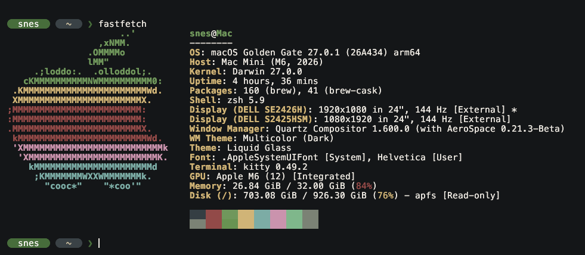

# Mac mini dotfiles



Config for Mac mini (M6/32GB/1TB).

```sh
rsync -a ~/Documents/mac_dotfiles/ ~/ --exclude README.md --exclude macos_settings.sh --exclude fastfetch.png
```

| File                                                       | What it is                                                                                                    |
| ---------------------------------------------------------- | ------------------------------------------------------------------------------------------------------------- |
| `Brewfile`                                                 | Every app, tool, and font: `brew bundle --file ~/Brewfile`                                                    |
| `.zshrc`, `.zprofile`                                      | Shell: Homebrew, conda/mamba, Rust, starship                                                                  |
| `.config/karabiner/karabiner.json`                         | Keyboard: Alt/Windows swap on Razer, Linux-style Ctrl shortcuts, PrtScr screenshots, Thunar-style Finder keys |
| `.aerospace.toml`                                          | Tiling: Windows key + Q/E/B launch kitty/Finder/Firefox, H/J/K/L focus, 1-9 workspaces                        |
| `.config/kitty/`, `.local/state/theme/kitty_theme.conf`    | Kitty and Everforest colours                                                                                  |
| `.config/starship.toml`, `.config/zellij/`, `.config/mpv/` | Prompt, zellij, mpv                                                                                           |
| `.gitconfig`                                               | Git identity; GitHub logins go through `gh`                                                                   |
| `Library/Application Support/Code/User/`                   | VS Code settings and keybindings                                                                              |
| `macos_settings.sh`                                        | System settings: Dock, Finder, Spotlight on Win+R, window drag key, sleep                                     |
